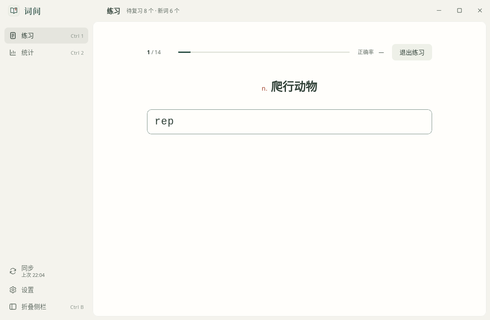

# 词间 (Cijian)

Read the Chinese meaning and the illustration, type the English word. 词间 is a Windows desktop app that schedules reviews with the FSRS memory model and reminds you when words are due. The vocabulary comes from the Word Atlas Anki deck, and answers from the office and home computers are merged through a small self-hosted sync server.

中文说明: [README.zh-CN.md](README.zh-CN.md)

## Repository Layout

| Directory | Contents |
| --- | --- |
| [`desktop/`](desktop/README.md) | The 词间 desktop app (Tauri 2 + Rust + Vue): spelling practice, FSRS scheduling, learning statistics. The main project. |
| [`server/`](server/README.md) | Sync server (Flask + SQLite): serves the Word Atlas snapshot read from Anki and merges the answer log of every computer. |
| `deck/` | Word Atlas Anki deck generator, entry revisions and the desktop media pack export. The deck is stable and rarely changes. |
| [`docs/`](docs/README.md) | Design, testing, deployment and deck notes (in Chinese). |

## Desktop App

- Chinese meaning and illustration as the prompt, English spelling as the answer; grades come from correctness and time, and FSRS schedules the next review.
- The waiting page shows the next review time; the tray icon turns orange shortly before words are due and red when they are.
- Free practice, difficult words and least-recently-practiced words all count toward memory and statistics; retyping this round's mistakes does not.
- A one-year calendar, a 30-day trend, CEFR level and topic progress, and per-word mistake history.
- Works offline; each saved answer uploads right away, the window fetches the other computer's answers when it comes back, and a full sync runs at startup and every 10 minutes.
- After 1,000 effective reviews, FSRS parameters are evaluated monthly in the background and only adopted when validation error improves.

Installers are published on GitHub Releases. See [desktop/README.md](desktop/README.md) (Chinese) for usage and development.

## Sync Server

`GET /api/vocab` returns the vocabulary snapshot read from Anki, `POST /api/sync` stores and pages the append-only answer log, and a background job copies `collection.anki2` from anki-sync-server. Access uses a bearer token. It runs with Docker Compose and is built and deployed by GitHub Actions on merges to master.

## Deck

`deck/` builds the 7,298-word Anki deck from a local Word Atlas checkout with `genanki` (one English-to-Chinese card per word, with illustrations and UK/US audio) and exports the desktop media pack. See [Word Atlas deck](docs/deck/word-atlas.md).
