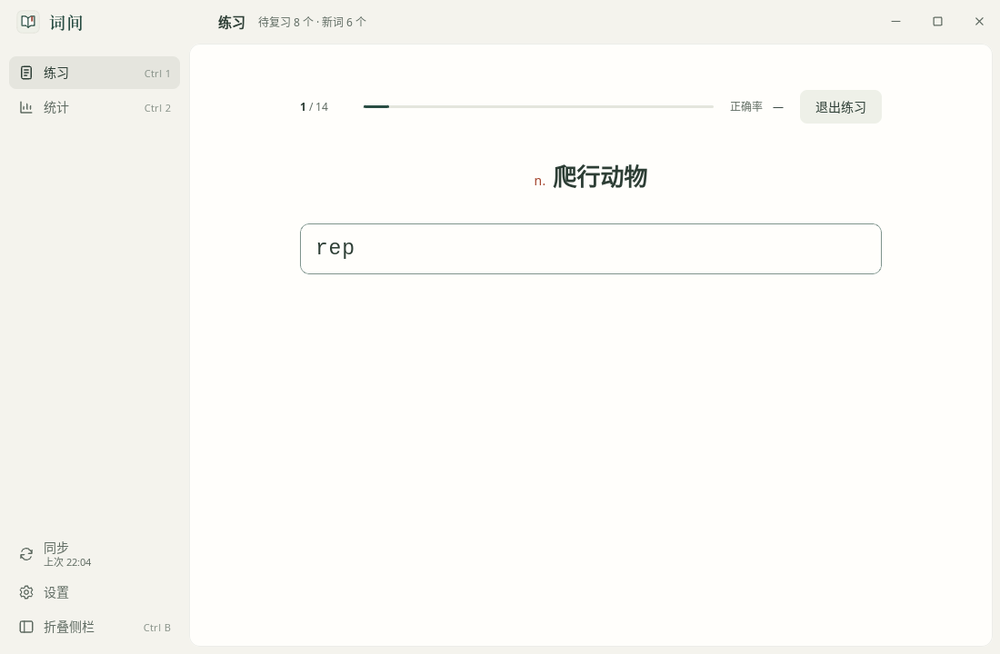

# 词间

看中文释义，拼出英文单词。词间是一个 Windows 桌面应用：按 FSRS 记忆模型安排复习，到点提醒；词库来自 Anki 的 Word Atlas 牌组，作答经自建的同步服务在公司和家里的电脑之间合并。

English README: [README.md](README.md)

## 仓库结构

| 目录 | 内容 |
| --- | --- |
| [`desktop/`](desktop/README.md) | 桌面端“词间”（Tauri 2 + Rust + Vue）：拼写练习、FSRS 调度、学习统计，本仓库的主体 |
| [`server/`](server/README.md) | 同步服务（Flask + SQLite）：从 Anki 读取 Word Atlas 词库快照，汇总各台电脑的作答日志 |
| `deck/` | Word Atlas Anki 牌组生成器、词条修订表和桌面资源包导出；牌组已稳定，很少改动 |
| [`docs/`](docs/README.md) | 设计、测试、部署与牌组文档 |

## 桌面端

- 中文释义作提示，拼写英文；按正误与用时自动评分，交给 FSRS 安排下次复习。
- 等待页显示下次复习时间，托盘图标到期前变橙、到期变红。
- 自由练习、难点突破、久未练习都计入记忆和统计；本轮错词重练不计入。
- 一年学习日历、最近 30 天趋势、CEFR 等级与话题进度、逐词答错记录。
- 离线可练；每题保存后立即上传，切回窗口时取回另一台电脑的作答，启动时和每 10 分钟完整同步一次。
- 累计 1,000 条有效复习后后台按月评估 FSRS 参数，只在验证误差更低时启用。

安装包从 GitHub Releases 下载，使用与开发说明见 [desktop/README.md](desktop/README.md)。

## 同步服务

精简的 Flask 服务：`GET /api/vocab` 返回从 Anki 读取的词库快照，`POST /api/sync` 保存并分页返回只追加的作答日志，后台定时从 anki-sync-server 复制 `collection.anki2`。使用 Bearer 访问令牌，通过 Docker Compose 部署，合入 master 后由 GitHub Actions 自动构建并部署。见 [server/README.md](server/README.md) 与 [Docker 部署](docs/server/DOCKER-DEPLOY.md)。

## 牌组

`deck/` 用本地 [Word Atlas](https://github.com/designfuchen/word-atlas) 词库与 `genanki` 生成 7,298 词的 Anki 牌组（每词一张英→汉卡，带插画与英美发音），并导出桌面端的插图与读音资源包。见 [Word Atlas 牌组](docs/deck/word-atlas.md) 和 [本地修订表](deck/data/word-atlas-revisions/README.md)。

## 文档

文档按知识库方式维护：只写项目约定、边界、接口和排障入口。从 [文档索引](docs/README.md) 开始。
