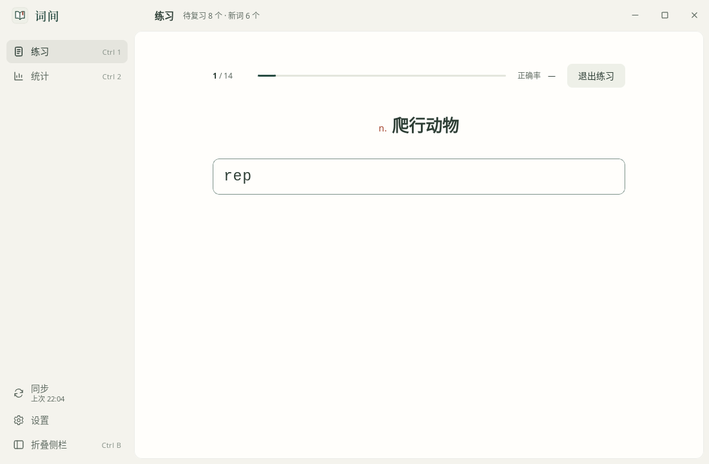
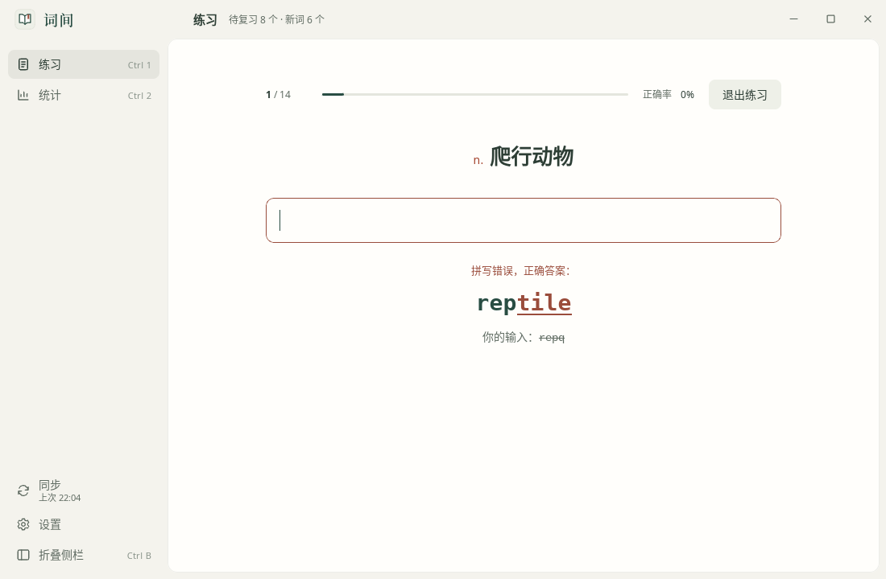
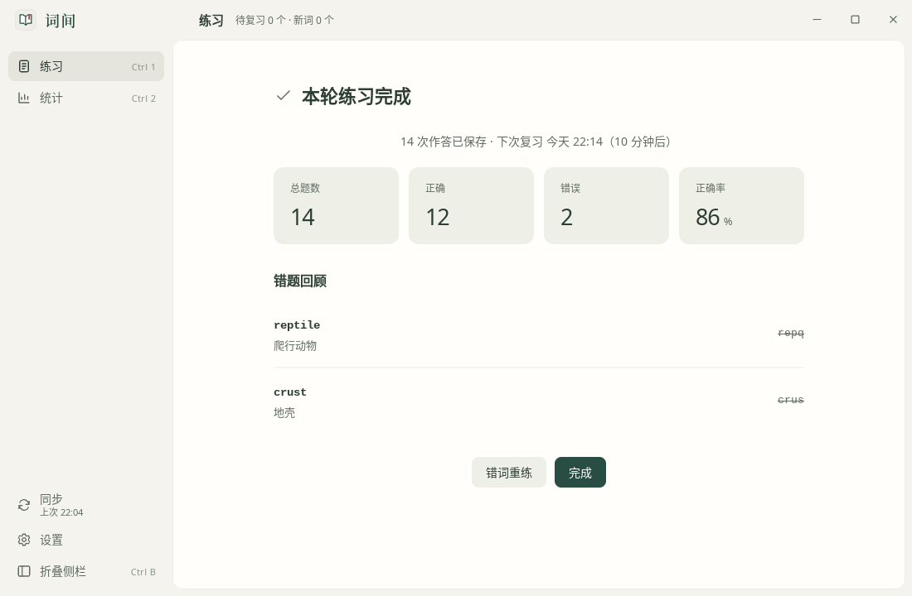
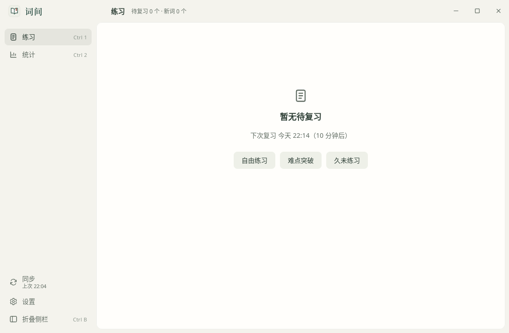
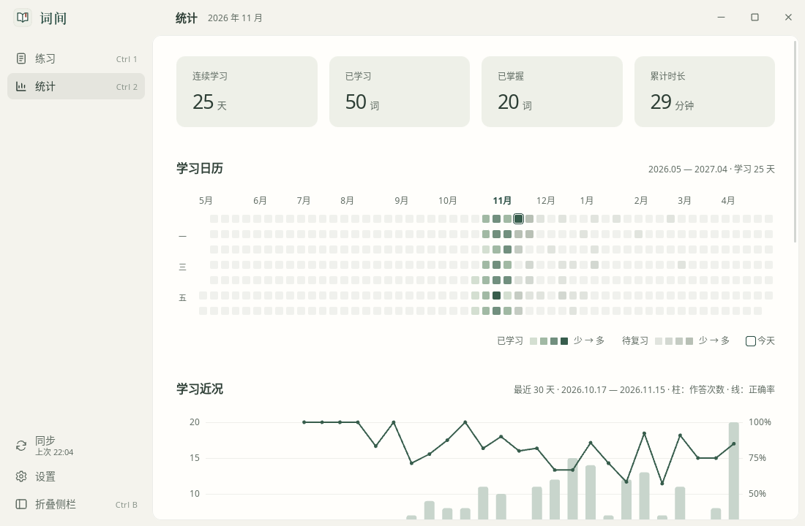
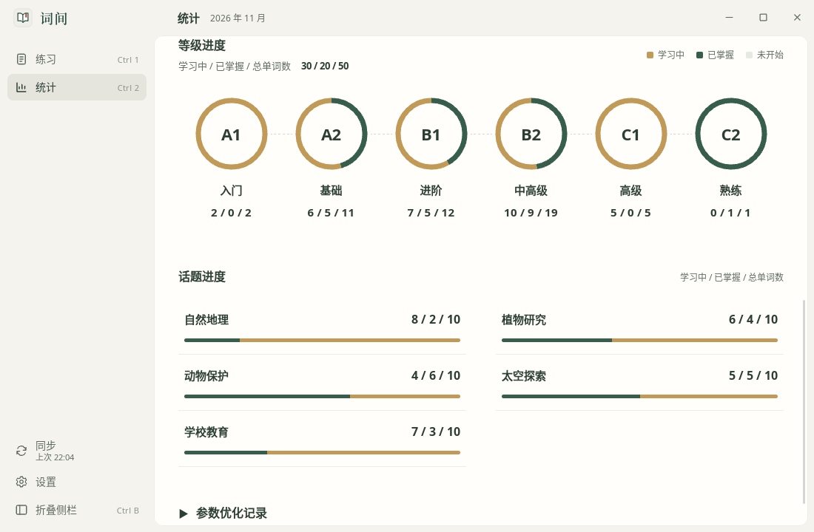
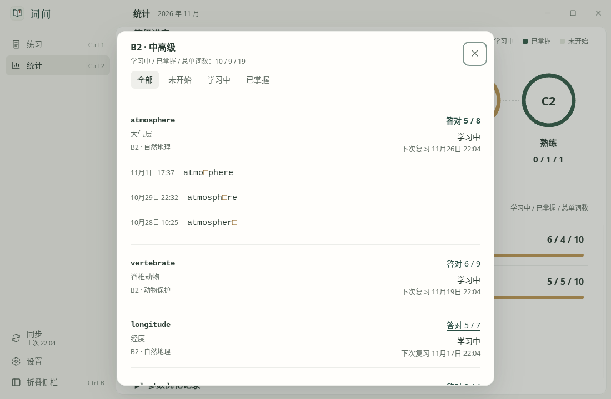

# 词间

看中文释义和插图，拼出英文单词。词间是一个 Windows 桌面应用：按 FSRS 记忆模型安排复习，到点提醒；词库来自 Anki 的 Word Atlas 牌组，作答经自建的同步服务在公司和家里的电脑之间合并。



## 功能

- **拼写练习**：中文释义和插图作提示，`Enter` 提交，输入框为空时按 `Space` 看答案；答错后订正拼写，再按 `Enter` 继续。
- **自动评分**：不用手动打分。答错或看答案记为 Again，答对时按用时记为 Easy（6 秒内）、Good（6–20 秒）或 Hard（20 秒以上），交给 FSRS 安排下次复习。
- **到点提醒**：练完显示本轮结果和错题，等待页显示下次复习时间与倒计时，到点出现“开始复习”。关闭窗口时收进托盘，托盘图标在到期前 10 分钟变橙、到期变红。
- **额外练习**：自由练习（可提前复习）、难点突破（最易错的 20 个词）、久未练习（最久没练的 20 个词）、本轮错词重练。除错词重练外都计入记忆和统计。
- **学习统计**：连续学习天数、一年学习日历、最近 30 天作答量与正确率、CEFR 等级与话题进度，以及每个词的逐次答错记录。
- **多台电脑轮流用**：作答先保存在本机，每题保存后立即上传；打开或切回窗口时取回另一台电脑的作答，屏幕上已在别处答过的题自动换掉。启动时和每 10 分钟另做一次含词库的完整同步，断网照常练习，联网后补传。
- **插图与读音**：资源包单独导入，点击释义或单词依次播放英音、美音。
- **自动优化**：累计 1,000 条有效复习后，后台每月评估一次 FSRS 参数，只在验证误差更低时启用。

## 截图

| 答错后订正 | 本轮结果 |
| --- | --- |
|  |  |
| **等待下次复习** | **学习统计** |
|  |  |
| **等级与话题进度** | **单词明细与答错记录** |
|  |  |

截图使用演示数据，由 [`e2e/screenshots.py`](e2e/screenshots.py) 生成：在 Linux 的 WebKitGTK 上渲染，字体与 Windows 略有不同，也没有导入插图资源包。

## 安装与开始使用

1. 从 GitHub Releases 下载 `Cijian_<版本>_x64-setup.exe`，安装到当前用户（Windows x64）。之后在“设置 → 软件更新”里检查并安装新版本。
2. 部署同步服务，见 [typing-practice](../typing-practice/README.md)。首次启动时，在弹出的“同步”面板里填写服务器地址和访问令牌，点“连接并同步”。
3. （可选）在“设置 → 插图与音频”导入 `cijian-media.zip`，资源包的生成见 [独立媒体资源包](../docs/typing-desktop/MEDIA.md)。没有资源包也能练习文字。
4. （可选）在“设置 → 启动与窗口”里开启开机自启动，或把关闭窗口改为直接退出。

### 快捷键

| 按键 | 作用 |
| --- | --- |
| `Enter` | 提交答案；订正后继续；在结果页和等待页执行主按钮 |
| `Space`（输入框为空） | 看答案 |
| `Esc` | 退出练习；关闭弹窗 |
| `Ctrl+1` / `Ctrl+2` | 切换到练习 / 统计 |
| `Ctrl+B` | 折叠侧栏 |
| `Ctrl+,` | 打开设置 |
| `F5` / `Ctrl+R` | 重新读取当前页数据（不发起同步） |

### 数据与同步

- 数据保存在 `%APPDATA%\com.yleoer.cijian`：本地数据库、服务器设置和导入的资源包。
- 正式作答答一题存一题。应用重启后直接接着出下一道到期题，只丢弃本轮统计和未答完的额外练习。
- 设计上一次只在一台电脑上练习：作答日志合并后，按作答时间重放得到同一套复习计划。各电脑独立优化 FSRS 参数，暂不同步，见 [SRS 计划](../docs/typing-desktop/SRS-PLAN.md#待办多设备参数优化同步)。

## 开发

| 目录 | 内容 |
| --- | --- |
| `core/` | `cijian-core`：判题、FSRS、本地 SQLite（`store.rs`）、统计（`stats.rs`）、参数优化（`optimize.rs`）、作答日志同步（`sync.rs`、`remote.rs`）、页面接口（`api.rs`） |
| `app/` | Tauri 2 壳：`cijian://` 协议转发到 `core`，页面来自编译时内嵌的 `dist/`；托盘、窗口与开机自启动 |
| `frontend/` | Vue 页面模板、脚本、样式和前端测试 |
| `e2e/` | 真实窗口测试与 README 截图脚本（Linux） |
| `vendor/` | 固定版本的 Vue 3.4.21、axios 1.6.7、ECharts 5.4.3 及许可证 |
| `scripts/` | 前端打包、版本号、FSRS 基准生成（含参考实现 `srs_reference.py`）、WebView2 调试脚本 |
| `fixtures/` | py-fsrs 对照基准 |

### 构建与运行

需要 Rust 工具链、MSVC 生成工具和 Node.js（见设计文档的“本机环境”）。在仓库根目录：

```powershell
# 1. 准备前端（需要 Jinja2，.venv 已带）
node typing-desktop\scripts\prepare.mjs

# 2. 编译并启动
cd typing-desktop
npm install
cargo run -p cijian
```

页面在编译时内嵌，修改模板或脚本后要重新执行 `build_frontend.py` 再编译。`npm run tauri -- dev` / `build` 会自动准备前端；`build` 在 `target/release/bundle/nsis/` 生成 NSIS 安装包和更新签名，需要签名环境变量，发布流程见 [发布与更新](../docs/typing-desktop/RELEASING.md)。

Linux 上也能编译运行，用来检查页面（正式版只发布 Windows）。先安装 Tauri 2 的系统依赖：

```bash
sudo apt install -y libwebkit2gtk-4.1-dev build-essential libxdo-dev libssl-dev libayatana-appindicator3-dev librsvg2-dev
python3 typing-desktop/scripts/build_frontend.py
cd typing-desktop && CIJIAN_DATA_DIR=/tmp/cijian-dev cargo run -p cijian
```

Linux 的页面地址是 `cijian://localhost/`，渲染引擎为 WebKitGTK，字体和细节与 Windows 的 WebView2 略有差异。前端接口地址必须写成相对路径 `/api`：Axios 会拒绝 `cijian:` 开头的绝对地址。

### 环境变量（均可选）

| 变量 | 默认 |
| --- | --- |
| `CIJIAN_DATA_DIR` | `%APPDATA%\com.yleoer.cijian`；数据库、`server.json` 与 `desktop.json` 的位置，开发和测试时可指向临时目录 |
| `CIJIAN_DB_PATH` | 数据目录下的 `cijian.db` |
| `CIJIAN_MEDIA_DIR` | 数据目录下的 `media/`，保存导入的资源包与 `active.json` |
| `CIJIAN_OPTIMIZATION` | 设为 `0` 关闭自动参数优化（已启用的参数保留） |
| `CIJIAN_SERVER_URL` / `CIJIAN_SERVER_TOKEN` | 同步服务器地址与令牌；设置后跳过首次连接，同步面板只展示地址 |
| `CIJIAN_SYNC_MINUTES` | 完整同步（含词库）间隔（分钟），默认 `10`；作答后和窗口切回时的作答同步不受此影响 |
| `CIJIAN_DEVTOOLS_PORT` | 开启 WebView2 远程调试端口，供 `scripts/cdp.mjs` 使用 |

服务器设置的优先顺序：环境变量 > 数据目录的 `server.json`（同步面板保存）> 首次启动弹窗。

在 Windows 上调试真实窗口：设置 `CIJIAN_DEVTOOLS_PORT=9333` 后启动，再运行 `node typing-desktop\scripts\cdp.mjs eval "document.title"` 或 `node typing-desktop\scripts\cdp.mjs shot practice.png`。

### 测试

```bash
cd typing-desktop && cargo test                          # Rust core 与桌面壳
node --test typing-desktop/frontend/src/*.test.cjs       # 前端逻辑（仓库根目录）
python3 typing-desktop/e2e/run.py                        # 真实窗口（Linux，约 2.5 分钟）
python3 typing-desktop/e2e/screenshots.py                # 重新生成 README 截图
```

分层、按改动选择测试、真实窗口测试的环境准备，以及发布前在 Windows 上的手工检查，见 [桌面端测试](../docs/typing-desktop/TESTING.md)。

### FSRS 对照基准

用 py-fsrs 和 `scripts/srs_reference.py`（原网页版 `srs.py`，仅作参考实现）生成 Rust 实现的比对数据，输出可复现：

```powershell
.\.venv\Scripts\python.exe typing-desktop\scripts\gen_fsrs_fixtures.py
```

输出 `fixtures/fsrs-golden.json`。修改评分或调度规则时，同时修改 `srs_reference.py` 与 Rust 实现，重新生成并提交。

## 文档

- [产品说明](../PRODUCT.md) · [视觉设计](../DESIGN.md)
- [桌面端设计](../docs/typing-desktop/DESIGN.md) · [前端说明](../docs/typing-desktop/FRONTEND.md) · [统计页面](../docs/typing-desktop/statistics/FRONTEND.md)
- [选词规则](../docs/typing-desktop/WORD-SELECTION.md) · [FSRS 与参数优化](../docs/typing-desktop/SRS-PLAN.md) · [独立媒体资源包](../docs/typing-desktop/MEDIA.md)
- [桌面端测试](../docs/typing-desktop/TESTING.md) · [发布与更新](../docs/typing-desktop/RELEASING.md)
